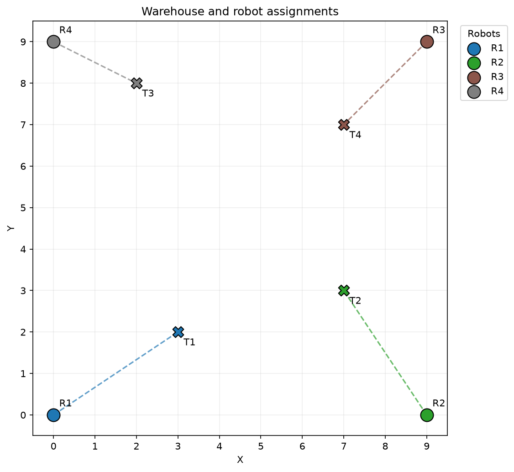
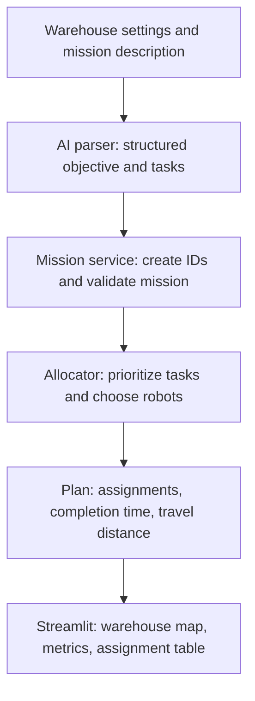

# SwarmPlanner AI — Version 1

Turn a plain-language warehouse inspection request into a validated mission, robot assignments, and a visual plan.

Version 1 connects an AI mission parser, a task allocation engine, and a Streamlit dashboard. Configure a warehouse, describe the work, and see which robot handles each task alongside estimated completion time and travel distance.

## Visual preview



*Illustrative example rendered by the same visualizer used in the app. Task coordinates are fixed for this documentation example; AI-generated missions can produce different locations and assignments.*

| Visual | Meaning |
| --- | --- |
| Colored circle (`R1`, `R2`, …) | Robot starting position; each robot has a different color |
| Cross (`T1`, `T2`, …) | Task location, colored to match its assigned robot |
| Dashed line | Travel between a robot's starting position and its tasks in assignment order |
| Dark cell, when present | Obstacle supplied through the warehouse model |

## Run locally

Use Python 3.10 or newer. Development has been checked with Python 3.14.

From the project directory in PowerShell:

```powershell
# Create the environment if you do not already have one
python -m venv .venv

# Install application dependencies
.\.venv\Scripts\python.exe -m pip install -r requirements.txt
```

Create a `.env` file in the project root with your API key:

```dotenv
OPENAI_API_KEY=your_api_key_here
```

Keep this file private; `.env` is excluded from Git. Mission generation requires an OpenAI API key and an internet connection. The initial warehouse preview works without a key.

Start the dashboard:

```powershell
.\.venv\Scripts\python.exe -m streamlit run app.py
```

Open the local URL printed in the terminal, normally `http://localhost:8501`.

## Walkthrough

1. **Set up the warehouse.** In the sidebar, choose width and height (2–50 cells), robot count (1–8), and robot speed in cells per simulated minute. Robots are spread around the warehouse perimeter. The grid must have enough perimeter cells for the selected robots.
2. **Describe the mission.** For example:

   > Inspect the loading dock, storage shelves, emergency exits, and maintenance area. The loading dock is the highest priority.

3. **Select Generate plan.** The AI extracts an objective and 1–8 inspection tasks. Each task includes a name, illustrative grid coordinates, priority from 1 to 5, and an estimated duration in simulated minutes.
4. **Validate and assign.** The mission service creates task IDs and validates the mission. The allocator considers higher-priority tasks first and assigns each task to the robot that can finish it earliest.
5. **Read the result.** The dashboard displays the objective, estimated overall completion time, total travel distance, warehouse map, and assignment table. Match each task's color to its robot in the legend.
6. **Try another setup.** Changing warehouse dimensions, robot count, or speed clears the previous plan. Generate a new plan for the updated setup. Editing the mission description takes effect when you submit it again.

For the fixed example pictured above, the allocator produces:

| Task | Inspection | Priority | Robot | Start (min) | Finish (min) |
| --- | --- | --- | --- | --- | --- |
| T1 | Loading dock | 5 | R1 | 0.00 | 5.61 |
| T3 | Emergency exits | 4 | R4 | 0.00 | 4.24 |
| T2 | Storage shelves | 3 | R2 | 0.00 | 5.61 |
| T4 | Maintenance area | 2 | R3 | 0.00 | 4.83 |

The overall completion estimate is **5.61 minutes** and total travel is **12.28 cells**. All four robots can begin traveling at time zero. A task's start time marks the start of its scheduled travel and work; it is not its arrival time.

## What happens behind the scenes



The AI interprets the request; the Python allocator makes robot assignment decisions. Mission validation checks bounds, duplicate IDs, priorities, durations, and whether starting or task positions occupy obstacles.

For each task, the allocator calculates:

```text
travel time = straight-line distance from the robot's planned position / speed
finish time = robot's existing workload + travel time + task duration
```

It selects the earliest finish time, breaking ties by lower workload and then robot ID. It updates that robot's planned endpoint and workload before considering the next task. Equal-priority tasks are considered in task ID order. The plan's completion time (makespan) is the latest robot finish time; total distance sums all assigned travel segments.

## Project files

| File | Role |
| --- | --- |
| `app.py` | Streamlit entry point, settings, mission input, and results |
| `visualizer.py` | Warehouse grid, robot colors, task markers, and assignment lines |
| `Ai_parser.py` | OpenAI structured mission parsing |
| `models.py` | Validated positions, robots, tasks, warehouse, and mission |
| `mission_service.py` | Connects parsing, mission validation, and allocation |
| `optimizer.py` | Priority-based greedy task allocation and plan metrics |
| `tests/` | Model validation, allocator behavior, and mission service tests |
| `requirements.txt` | Application dependencies |

## Run tests

```powershell
.\.venv\Scripts\python.exe -m pip install pytest
.\.venv\Scripts\python.exe -m pytest -q
```

The current suite contains 14 tests. Mission service tests use a fake parser and do not require live API calls.

## Version 1 scope and next steps

Version 1 delivers natural-language mission parsing, validated mission data, task assignment, and an interactive planning dashboard.

Coordinates chosen by the AI are illustrative, not a mapping of a real warehouse. Travel uses Euclidean straight-line distances. The model and visualizer support obstacles, but the dashboard currently creates an empty warehouse and the allocator does not route around obstacles. Assignment lines represent a static plan; robot animation, collision avoidance, and dynamic replanning remain future work. The greedy allocator does not guarantee a globally optimal plan.
